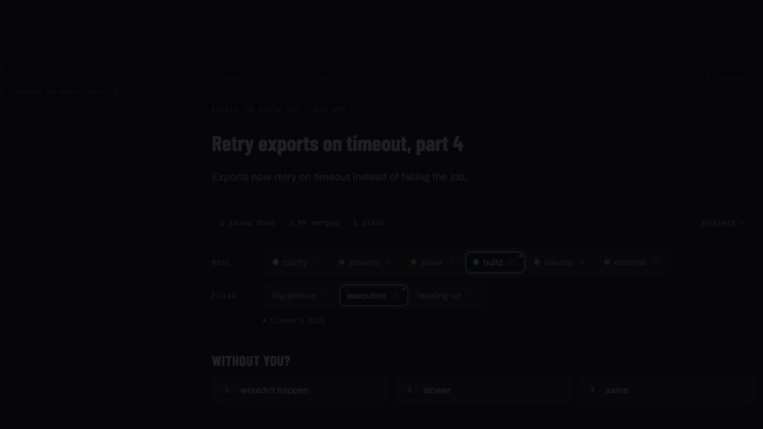

# impact-trace

Weekly impact tracking for engineers.



All data in the demo is fictional.

## Quick start

```bash
git clone https://github.com/nicolastakashi/impact-trace && cd impact-trace
bun install
bun start      # open http://127.0.0.1:4317: it starts on Setup
./run.sh       # collect this week, then review it in the app
```

Until your first review, North and Trace show fictional example data, marked "example".

## You need

- [Bun](https://bun.sh).
- [GitHub CLI](https://cli.github.com), logged in: `gh auth login`.
- `jq` and `python3`. macOS has `python3`; `brew install jq` for the other.
- [Claude Code](https://claude.com/claude-code), with these claude.ai connectors on your account:
  Linear, Slack, Google Calendar and Google Drive. `run.sh` calls their tools by name
  (`mcp__claude_ai_Linear__list_issues` and others), so they must be the claude.ai ones.

The Setup page checks the GitHub CLI and Claude Code for you.

## Every day, without thinking about it

```bash
./schedule.sh install    # weekdays at 18:00 (macOS, launchd). Or: remove. Logs in data/logs/
```

Each run first closes every ended week that has no feedback yet, weekend included: usually
last week on a Monday, but also a Monday the Mac slept through or a run that failed. After
Monday it also collects this week so far. More in [schedule](docs/schedule.md).

Rather keep the app in a container? Collection stays on your machine, where your Claude
Code login and connectors are; both read and write the same `data/`.

```bash
docker compose up -d --build   # http://127.0.0.1:4317, rebuild after code changes
```

## More commands

```bash
./run.sh 2026-10-12      # collect the week of that Monday
./draft-goals.sh         # Claude drafts objectives from your data; you use or dismiss them
PORT=4318 bun start      # a second copy next to yours, e.g. a fresh clone with its own data/
```

`data/` holds your work data and `config.json`. It is git-ignored and must never be pushed.

## What it does

Claude Code collects the facts from GitHub, Linear, Slack, Calendar and Docs through
CLIs and MCPs. Code here only validates them, stores them in SQLite, and shows them.

```
claude -p (skills) ━▶ data/raw/<week>/*.json ━▶ ingest ━▶ data/impact.db ━▶ app
```

North and Trace show the threads you kept in review, the last 8 weeks.

Feedback reads the Slack messages you wrote in the last 8 weeks and names patterns in how you
show up, with your own words quoted and a stronger version. It runs once a week, after the week
ends. The code drops any quote it cannot find in your messages and makes every count, so the
one experiment it proposes is measured the next week. Accept or reject each piece, with a
reason if you want: the next run reads your verdicts and does not repeat what you rejected.

Claude may only flag the categories in `jobs/feedback-categories.json`. Each one has a source
(Reilly, Larson, Marquet, research on hedges), shown on its card as "Why this counts". Cards
follow SBI (Situation, Behavior, Impact) and end with what to say next time.

One week cost $0.67 on 2026-10-19: collection with Haiku, projects and labels with Sonnet.
Each scheduled run costs about that, so weekdays add up to about $3.35 a week. Feedback adds
$0.66, once a week. `ingest` exits 2 when a source failed or when Claude returned fewer GitHub
PRs than `gh` counts on its own.

## How it works

| Part | Doc |
|---|---|
| Collect from 5 sources, checked by code | [collect](docs/collect.md) |
| Group events into threads and projects | [threads](docs/threads.md) |
| Review: Claude suggests, you decide | [review](docs/review.md) |
| North, Trace and Projects | [views](docs/views.md) |
| Goals your work serves | [goals](docs/goals.md) |
| Draft, follow and close a quarter of goals | [goal cycle](docs/goal-cycle.md) |
| Feedback on how you show up | [feedback](docs/feedback.md) |
| The daily schedule, with no gaps | [schedule](docs/schedule.md) |
| Ask questions about your data | [ask](docs/ask.md) |
| The words the app uses | [glossary](docs/glossary.md) |

## Working on the code

```bash
bun run qa               # ESLint, then click-through tests in your Chrome, on fictional data
bun test core jobs       # unit tests
bun run fmt              # format the code (Prettier)
```

- `jobs/`: the steps `run.sh` runs (ingest, labels, mentions, feedback, drafts).
- `core/`: what the jobs and the server share: the database, threads, goals, metrics.
- `app/`: the server, one file per API area. `web/`: the React app.

More in [qa](docs/qa.md) and [react](docs/react.md).
